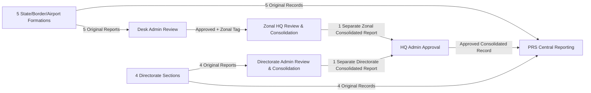

# NIS REDAS Option C Reporting Workflow

## Overview

Option C enforces strict separation between **Original Reports** submitted by formations/sections and **Consolidated Reports** prepared by Zonal Headquarters and Directorates. A consolidated report **never** replaces, overwrites, hides, or erases the original reports used to prepare it.

## Record Accounting Invariant

- **Zonal Example:** 5 formations submit 5 original reports; Zonal HQ prepares 1 Zonal Consolidated Report. PRS receives and independently inspects **6 separate records** (5 original + 1 consolidated).
- **Directorate Example:** 4 sections submit 4 original reports; the Directorate prepares 1 Directorate Consolidated Report. PRS receives and independently inspects **5 separate records** (4 original + 1 consolidated).
- **Completeness Calculation:** Completion percentage measures `received_original_units / expected_original_units`. Consolidated reports are never counted as substitutes for missing original reports.

## Versioning, Lineage & Staleness

1. Every submission (`SubmissionWorkflow::create`) creates `report_versions` version `v1` and extracts structured numeric metrics into `report_indicator_values` (`is_current = true`).
2. When a Zonal Commander or Directorate Admin creates a consolidated report (`/consolidated/create`), `consolidated_report_sources` links each included or excluded original report to its exact `report_version_id` at the time of consolidation. Excluded originals require an explicit exclusion reason.
3. If an original source report is later edited and resubmitted, `ReportVersioning::snapshot()` creates `v2` (preserving `v1` untouched) and `ConsolidationService::flagStaleSources()` marks dependent consolidated reports as `is_stale = true` without silently altering their figures.
4. Stale consolidated reports cannot be submitted until an authorized reviewer explicitly creates a new revision (`Rev N+1`), preserving all prior revisions and `approved_revision_no`.

## Key Routes

- `/consolidated` — Zonal Commander & Directorate Admin consolidation workspace
- `/admin/consolidated-reports` — HQ Admin consolidated approval queue
- `/prs/dashboard` — PRS Central Reporting Dashboard (zone, directorate, formation status + unified separate-record register)
- `/prs/indicators` — National structured statistical indicator totals
